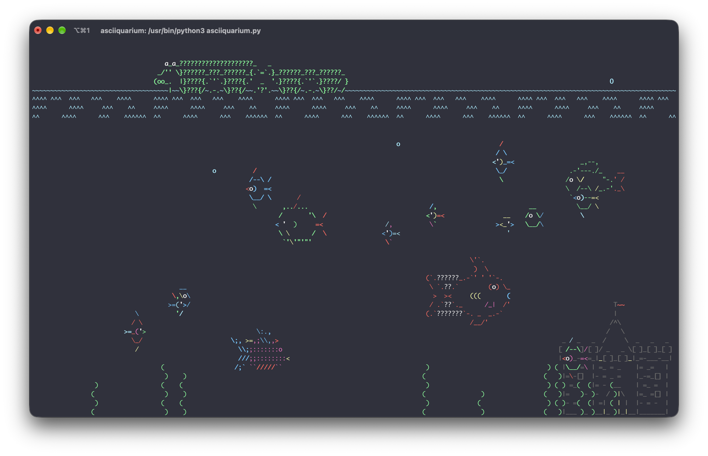

# Asciiquarium



An aquarium/sea animation in ASCII art, running in your terminal.


This is a Python port of the original [Asciiquarium](http://www.robobunny.com/projects/asciiquarium/) by Kirk Baucom, with all original ASCII art and behavior preserved.

## Features

- Animated fish, sharks, whales, ships, sea monsters, and more
- Castle, seaweed, and bubbles
- Colorful ASCII art rendered with curses
- Scales fish and seaweed count to your terminal size
- Classic mode to show only the original species from v1.0

## Requirements

- Python 3.6+
- A terminal with curses support (macOS, Linux, WSL)
- No external dependencies

## Usage

```bash
python3 asciiquarium.py
```

### Options

| Flag | Description |
|------|-------------|
| `-c` | Classic mode -- only show species from Asciiquarium 1.0 |

### Controls

| Key | Action |
|-----|--------|
| `q` | Quit |
| `r` | Redraw (recreates all entities) |
| `p` | Toggle pause |

## Credits

- **Kirk Baucom** -- original Asciiquarium in Perl
- **Joan Stark** -- most of the ASCII art
- **Claudio Matsuoka** -- improved marine biodiversity (backported from the Android live wallpaper)

## License

GPL v2 -- see [gpl.txt](gpl.txt) for details.
